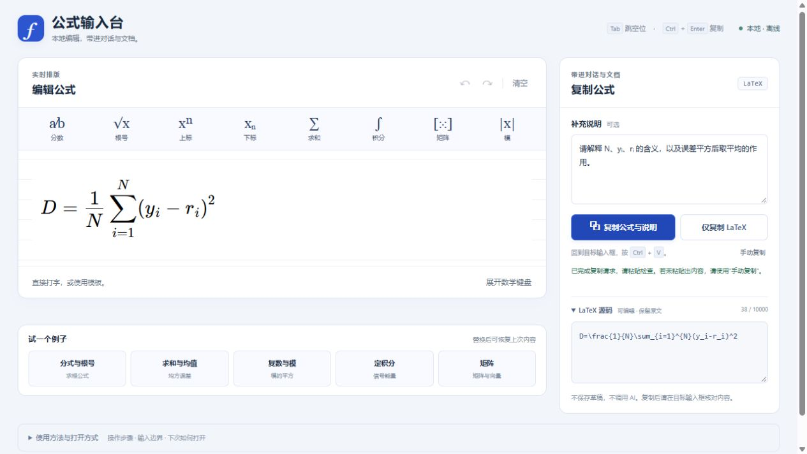

# FormulaDesk · 公式输入台

离线可视化 LaTeX 编辑器。边输入边看公式，再复制到 AI 对话、Markdown 或文档。

**不需要安装、账号、API Key 或后台服务。** 全部脚本与字体打包在一个 HTML 文件里。
[English overview](README.en.md) · [快速使用](docs/QUICKSTART.md) · [兼容性与边界](docs/compatibility.md)

[下载便携版](https://github.com/hezhiheng1999/FormulaDesk/releases/latest) · [GitHub 仓库](https://github.com/hezhiheng1999/FormulaDesk) · [GitHub Actions](https://github.com/hezhiheng1999/FormulaDesk/actions)

## 适合谁

- 想用分数、上下标、积分、矩阵表达问题，又不想先背完整 LaTeX 的学习者。
- 希望检查公式结构后，再把文本带入 AI 对话的研究者和教师。
- 需要本地、可移动、无需软件安装的简短公式输入工具的使用者。

它提供公式文本，不嵌入或修改目标应用的输入框，也不连接任何 AI 服务。目标是否渲染 LaTeX、模型是否理解正确，需要在目标应用里核对。它不替代完整 LaTeX 文档系统、符号计算器、MathType 或 OCR。

## 获取与打开

**使用者：** 从[发布页](https://github.com/hezhiheng1999/FormulaDesk/releases/latest)获取 portable ZIP，完整解压，双击 `index.html`，用浏览器打开。Windows 也可双击 `open-formuladesk.cmd`。不要双击压缩包内的文件直接运行。

如果拿到的是已制作好的 source ZIP，其中也带有成品 HTML，可以直接打开。通过 Git 克隆源码则先按下面步骤构建；仓库不保存自动生成的 HTML。

**从源码构建：** 安装好的 Python 3.10+ 即可，不需要 pip 或 npm 依赖：

~~~text
python build.py
~~~

生成 `index.html`。Node.js 20+ 只用于测试，不是日常运行要求。固定版本依赖已放在 vendor/，普通构建不联网。

若系统将 HTML 打开成文本，右键选择“打开方式”，使用浏览器。建议先用 Edge 或 Chrome；平台与实测范围见[兼容性说明](docs/compatibility.md)。

## 使用

1. 在公式区打字，或用分数、根号、上下标等模板与数学键盘。按 Tab 跳过模板空位。
2. 可在 LaTeX 源码区粘贴已有公式。裸源码、完整的数学分隔符和单个 LaTeX 代码块都能处理。
3. 在“补充说明”写上变量含义、单位或问题。
4. “复制公式与说明”会添加先复述公式、指出歧义的提示；“仅复制 LaTeX”只复制公式。Ctrl/Command+Enter 也可发起复制。
5. 在目标输入框粘贴，核对文本后再发送。工具不会自动发送内容。

**自动复制无效时：** 点击“手动复制”，待文本选中后按 Ctrl/Command+C，再粘贴。工具不读取剪贴板来检查内容；API 成功提示也不能替代在目标输入框核对。

清空或载入示例会替换当前公式与说明，可通过“恢复上次内容”找回最近一次替换前的完整内容。公式内的撤销/重做用于可视化公式编辑，不是永久历史记录。

## 鲁棒性与数据保护

- 输入或说明超过 10000 字符、显式括号分组超过 64 层、连续控制指令超过 64 个时，保留原文并暂停相应操作，不截断输入。
- 未完成或未识别的源码暂停预览，不用自动补全后的模型覆盖原文。
- 链接和 HTML 扩展只作为源码保存；公式链接、朗读、远程字体与计算引擎入口被禁用。
- 复制请求处理中避免重复请求；内容变化后会说明复制的是点击时的内容。
- 排版组件不可用时仍可编辑、复制原始 LaTeX。
- 未复制内容离开页面时尝试触发浏览器提醒；提醒受浏览器限制，不是备份。
- 宽窗口并排编辑与复制，窄窗口按编辑、复制、示例排列，键盘焦点顺序与此一致。

工具**不保存草稿**。关闭或刷新前请复制需要保留的内容。它也不校验数学推导、物理单位或模型答案是否正确。

## 离线与隐私

运行资源全部内嵌，内容策略禁止网络连接、外部资源和表单提交。不自动保存输入、不调用 AI API、不自动读取剪贴板；复制操作写入系统剪贴板。

将公式粘贴到外部应用之后，后续数据处理由目标应用负责。系统剪贴板可能被其他应用访问。完整说明与报告方式见 [SECURITY.md](SECURITY.md)。

## 更新、卸载与再次打开

用浏览器收藏本地页面即可下次打开；移动文件夹后可能要重新收藏。更新时将新版解压到单独文件夹，验证后再替换旧版。卸载只需删除解压出的工具文件夹，不涉及注册表或服务。

旧本地名称 `公式输入台.html` 与同名启动文件仍可使用；构建会生成与 index.html 内容相同的兼容文件。

## 开发、测试和发布

~~~text
node --test
python -m unittest discover -s tests -p "test_*.py"
python build.py
python checks/check_bundle.py
python tools/package_release.py
~~~

测试没有需要安装的第三方依赖。构建核对固定 MathLive 包的完整文件清单与哈希，使用原子替换写入 UTF-8/LF 的 HTML。发布脚本生成 portable/source ZIP 与 SHA-256 校验文件，使用显式白名单排除本机记录和缓存。

[开发说明](docs/development.md) · [测试结果与手动检查](docs/testing.md) · [发布说明](docs/releasing.md) · [贡献指南](CONTRIBUTING.md)

GitHub Actions 提供跨系统构建与测试任务，实际结果见[运行记录](https://github.com/hezhiheng1999/FormulaDesk/actions)。检查与具体提交绑定；跨系统构建通过也不代表这些系统上的浏览器交互均已验证。

## 许可证与依赖

项目代码采用 [MIT](LICENSE)。基于 [MathLive](https://github.com/arnog/mathlive) 0.111.1，字体随其发布包提供。所有依赖固定版本，保留完整性记录和[第三方声明](THIRD-PARTY-NOTICES.txt)。自有代码、依赖和字体的许可证也嵌入成品 HTML。

